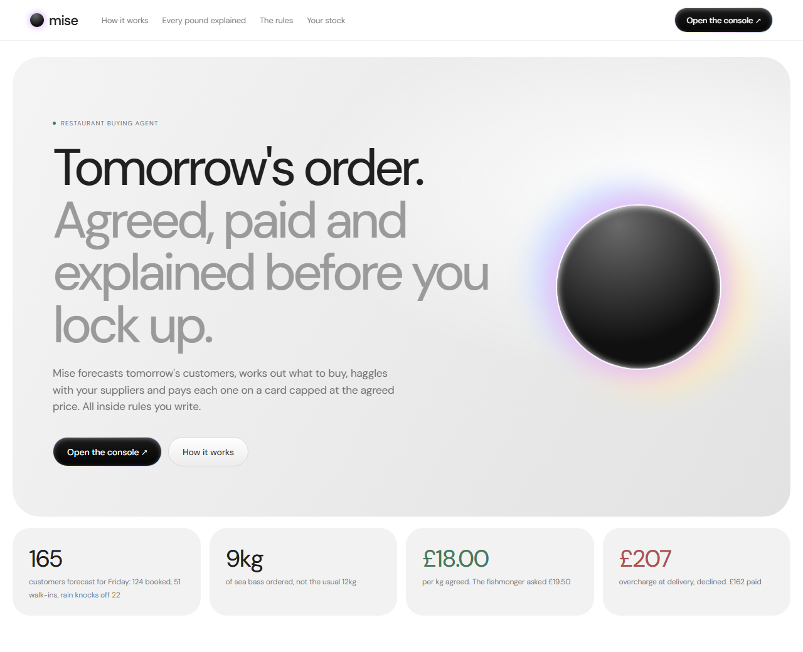
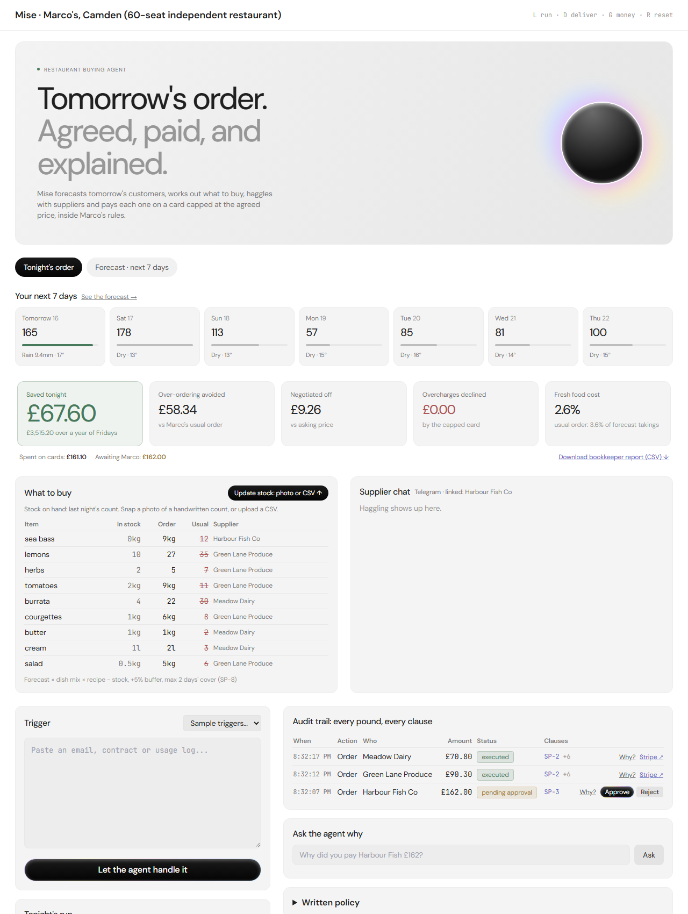
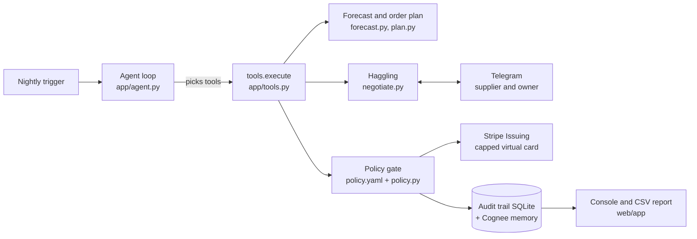
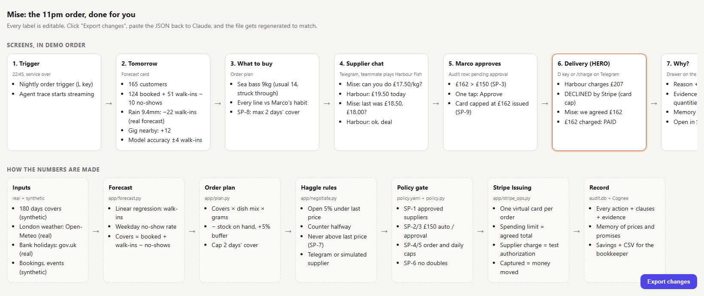

# Mise

Mise places a small restaurant's nightly food order for the owner. It forecasts tomorrow's customers, works out what to buy, haggles with suppliers over chat, and pays each one on a card capped at the agreed price. Every step follows rules the owner writes, and every pound can be explained afterwards.



Built in one evening at the Briefcase x Stripe hackathon in London (15 October 2026), Track 1: agents that spend. Payments run on Stripe in test mode.

## The problem

Picture Marco. He owns and cooks at a 60-seat restaurant in Camden. Every night around 11pm, after service, he texts his suppliers tomorrow's fish, veg and dairy order on gut feel. If he over-orders, fish goes in the bin. If he under-orders, a dish comes off the menu. He pays whatever price the supplier names, and he only spots an overcharge, if he ever does, when the invoice turns up weeks later.

Chains have forecasting tools for this, but those suggest an order and leave a purchasing manager to place it. A one-site owner has no purchasing manager. Mise is the purchasing manager.

## How it works

On the demo night (Thursday, ordering for Friday) a run goes like this:

1. **Forecast tomorrow's customers.** 124 people have booked. A regression model trained on 180 days of the restaurant's (synthetic) history predicts 51 walk-ins: 9.4mm of rain knocks off about 22, a cool evening about 11, and a sold-out gig nearby adds about 12. Take off Friday's usual 8% no-shows and that's **165 customers**.
2. **Plan the order.** Customers times the dish mix times each recipe, plus a 5% buffer, minus what's already in the fridge. Perishables are never bought for more than two days. That gives **9kg of sea bass**, against the 12kg Marco usually orders on a Friday. Stock on hand comes from last night's count, which can be updated by uploading a CSV or a photo of a handwritten count.
3. **Haggle with each supplier.** Mise messages the fishmonger on Telegram and opens 5% under the last price Marco paid (£18.50), at £17.50/kg. The fishmonger asks £19.50. Mise counters once and they settle at **£18.00/kg**. It is never allowed to agree a price above the last price paid.
4. **Ask before big spends.** The fish order comes to **£162**, which is over Marco's £150 limit, so it waits for him to tap Approve (in the console or on his phone through Telegram). The veg and dairy orders are under £150 and go through on their own.
5. **Pay on a capped card.** Each approved order gets its own Stripe Issuing virtual card with a spending limit of exactly the agreed total. The card is the purchase order.
6. **Refuse the overcharge.** At delivery the fishmonger tries to charge **£207**. It is declined, Mise replies "we agreed £162", and the supplier charges £162, which settles in Stripe.
7. **Explain every pound.** Ask "why did you pay Harbour Fish £162?" and Mise answers with the forecast, the order maths, the quotes it turned down and the rule ids that allowed it. Every action, allowed or blocked, is in the audit trail, and there is a CSV report for the bookkeeper with one row per order line.

The money screen adds up what the night saved: over-ordering avoided, money negotiated off, and overcharges declined. On the demo night that's about £185, or roughly £9,600 a year of Fridays. Those figures are priced against Marco's usual order at list price, using synthetic data, so treat them as an illustration rather than a measured result.



*The console mid-run. Veg and dairy were ordered and paid on their own; the £162 fish order is waiting for Marco.*

## Under the hood



A FastAPI app (`app/`) serves a JSON API and two static pages: a landing page and the owner's console. The console is plain HTML and JavaScript that polls the API every two seconds. There is no auth and no websocket; it's a one-evening build.

The decisions that matter:

- **Numbers come from code. Words come from the model.** The forecast, the quantities, the haggling prices and the card caps are all worked out deterministically. The model (OpenAI or Anthropic, chosen by which key is set) only decides which tool to call next and writes the messages. It can't invent a price, because `place_order` reads quantities and prices from the negotiation record, not from the model's arguments. With no model key at all, a scripted mode runs the same tools through the same gate, so the demo never depends on an API being up.
- **The rules are enforced in code, not in the prompt.** `policy.yaml` holds Marco's rules in plain English, each with a machine-readable `rule` block. `app/policy.py` checks every money action against them before anything reaches Stripe: approved suppliers only, auto-approve up to £150, owner approval above that, a £600 per-order ceiling, an £800 daily ceiling, no duplicate orders within 24 hours, never above the last price paid. Blocking rules win over approval rules, and if no rule authorises an action it's denied by default. The model is shown the rules but can't talk its way past them.
- **One path for money.** Every spend goes through `tools.execute`: policy check, then an audit row, then Stripe, then a memory write. The only other code that touches a card is the delivery route, which plays the supplier charging it and writes its own audit rows.
- **The card is the purchase order.** Normally the order, the delivery note and the invoice get matched by accounts payable a month later. Here the agreed total becomes the card's spending limit, so the check happens at the moment of payment.
- **Explaining is cheap and safe.** The "why" panel is built straight from the audit row and the matching rules, with no model call, so it is instant and can't make things up. Free-text questions go through the model, which is told to answer only from the audit trail and memory and to cite rule ids.
- **Memory that doesn't block payments.** Every action is written to a local file and to [Cognee](https://www.cognee.ai/) in the background. Recall uses Cognee when it answers within 30 seconds and falls back to keyword search over the local file when it doesn't, so a slow knowledge graph or bad venue wifi never stalls an order.
- **Real inputs where it was cheap.** London weather comes from Open-Meteo (180 days of history to train on, plus the live forecast), and bank holidays from gov.uk. The forecast model is a least-squares regression written in plain Python, and it reports its own error on a held-out four weeks (walk-ins within about 4 on average).

## What's real and what isn't

Being straight about the edges:

- **Stripe is test mode only.** The app refuses to start with a live key. Cards are real Stripe Issuing test cards with real spending limits, and the agreed charge is a real captured Issuing transaction in the test dashboard.
- **The £207 decline comes from Mise, not Stripe.** In the demo the overcharge is refused by the app's own check against the agreed total (`CAP_CHECK=code`) before Stripe sees it. Stripe's UK test sandbox declines card-not-present charges over roughly £160 to £200 for cardholder verification, whatever the card's limit is, so a Stripe decline there wouldn't prove the cap did its job. For the same reason, the agreed £162 is settled through Stripe's test helper for force capture rather than a normal authorisation. Setting `CAP_CHECK=stripe` sends the overcharge to Stripe instead.
- **The suppliers are simulated, or a person on Telegram.** In the demo a teammate played the fishmonger. If nobody replies within 90 seconds, a simulated supplier answers from a hidden floor price. Production would use the WhatsApp thread restaurants already use, which needs a business account and approved templates.
- **The restaurant is synthetic.** Bookings, walk-ins, no-shows, local events, the menu, suppliers, prices and stock are made-up seed data. London weather and bank holidays are real.
- **Stock is uploaded by hand.** Connecting to a restaurant's inventory or till system is future work.
- **Savings are illustrative.** They compare the planned order with a fixed "usual Friday order", priced at list price.

## The rules

From `policy.yaml`. The clause ids show up in the audit trail, in the "why" answers and in Stripe metadata.

| Id | Rule |
|---|---|
| SP-1 | Only order from and pay Harbour Fish Co, Green Lane Produce and Meadow Dairy. |
| SP-2 | Orders up to £150 go through on their own. |
| SP-3 | Orders over £150 wait for Marco to approve. |
| SP-4 | No single order over £600, approved or not. |
| SP-5 | No more than £800 of fresh food in one day. |
| SP-6 | Never the same order to the same supplier twice in 24 hours. |
| SP-7 | Never agree a unit price above the last price paid. |
| SP-8 | Buy for the forecast plus 5%, minus stock, and never more than two days' cover. |
| SP-9 | Each order is paid on its own card capped at the agreed total. |

## Built at

Briefcase x Stripe evening hackathon, London, 15 October 2026. Track 1: agents that spend. About three hours from idea to submission, built by team 3 Blind Mise.

## What I built

I came up with the concept, wrote the API contract, ran the Stripe Issuing and Telegram setup myself, and directed Claude Code through the backend: the forecast, the order plan, the haggling, the policy gate, the card flow, the audit trail and the bookkeeper report. The rest of the team played the suppliers on Telegram and owned the pitch and the demo video.

## Planning



*The wireframe drawn before the build, screen by screen in demo order. It is slightly out of date: it shows Stripe declining the overcharge, which moved into the app's own check (see above).*

## Run it locally

You need [uv](https://docs.astral.sh/uv/) and a Stripe account with Issuing turned on in test mode.

```bash
git clone https://github.com/Warisback/mise.git
cd mise
cp .env.example .env
```

On Windows use `copy .env.example .env`. Then fill in `.env`:

- `STRIPE_SECRET_KEY`: a test key (`sk_test_...`).
- `CAP_CHECK=code` to match the demo.
- `OPENAI_API_KEY` or `ANTHROPIC_API_KEY` for the agent. Or set `AGENT_MODE=scripted` to run with no model at all.
- `MEMORY_BACKEND=local` for zero setup. For Cognee, set `MEMORY_BACKEND=cognee` with `COGNEE_URL` and `COGNEE_API_KEY`, and run `uv sync --extra cognee` once.
- `TELEGRAM_BOT_TOKEN` (optional): make a bot with @BotFather.

The repo ships with the demo night's data (Thursday 15 October 2026, ordering for Friday). To regenerate it for tomorrow with today's real weather, run the seed. The numbers will differ from the ones above.

```bash
uv run python -m scripts.seed
```

Start the server. On Windows:

```powershell
.\dev.ps1
```

On macOS or Linux:

```bash
uv run python -m uvicorn app.main:app --port 8000
```

Open http://localhost:8000 for the landing page and http://localhost:8000/app/ for the owner's console. In the console:

- `L` runs tonight's order.
- `D` plays the delivery: the supplier tries to overcharge (declined), then charges the agreed total.
- `G` jumps to the money screen.
- `R` resets the audit trail and memory.

To play the supplier on Telegram, open your bot and send `/start harbour` (or `/start greenlane`, `/start meadow`). Reply to the agent's messages with a price, and at delivery charge the card with `/charge 207` and then `/charge 162`. To approve big orders from a phone, send `/start marco` from another chat and you'll get Approve and Reject buttons.

`.\dev.ps1 smoke` checks your keys and shows which Stripe features your account has.

## What's next

- Read stock from the restaurant's inventory or till system instead of a nightly upload, and learn the dish mix from actual sales.
- Swap Telegram for the WhatsApp Business thread suppliers already use, and handle partial and short deliveries, not just overcharges.
- Check each night's forecast against what actually sold, so the model and the buffer improve week by week, and push the bookkeeper report straight into the accounting ledger.

## Contact

Built by [Warisback](https://github.com/Warisback).
